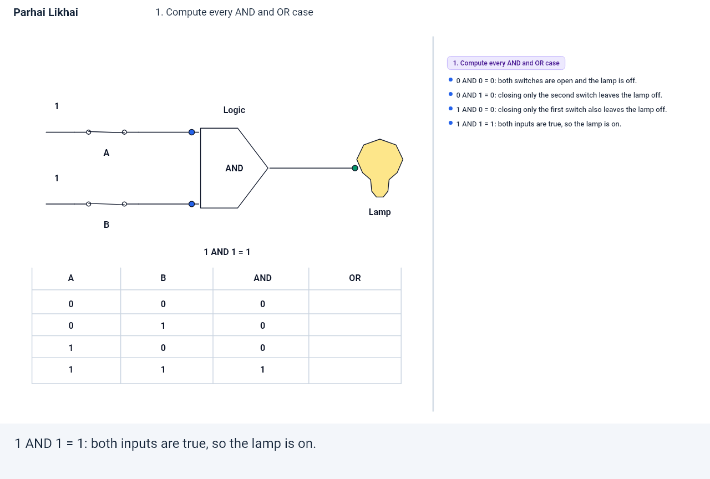
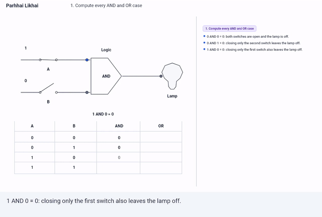

# Parhai Likhai

### Lessons that show how things work

Parhai Likhai is building animated lessons in which the learner can watch a process happen. Switches control a lamp. An enzyme binds a matching substrate and releases products. Water changes phase while its temperature graph follows the same state.

**[Watch the demos](https://qasimahmad-khan.github.io/parhailikhai/)** · **[See the current development stage](STATUS.md)** · **[Inspect the validation evidence](evidence/validation.json)**

## Start with these demos

Each video contains a mechanism, a concrete analogy, and a worked example. Videos are silent, with the lesson narration shown as captions.

| Demo | What to watch | Video | Contact sheet |
|---|---|---|---|
| AND and OR gates | Switches drive the wires, lamp, and truth table. A badge and PIN control a door, and sensors drive an alarm. | [Watch](videos/logic.mp4) | [View all chapters](images/logic-contact-sheet.jpg) |
| Enzyme action | A matching substrate docks, splits, and leaves. An incompatible shape is rejected, and the enzyme is reused. | [Watch](videos/enzyme.mp4) | [View all chapters](images/enzyme-contact-sheet.jpg) |
| Heating curve | Particles vibrate, slide, and escape. The curve holds through melting and boiling, and a crowd demonstrates the same state changes. | [Watch](videos/heating.mp4) | [View all chapters](images/heating-contact-sheet.jpg) |

## More golden examples

| Demo | Visible process | Video | Contact sheet |
|---|---|---|---|
| Refraction | Incident angles and optical media determine the refracted ray. A two-wheeled cart demonstrates the change in direction. | [Watch](videos/refraction.mp4) | [View](images/refraction-contact-sheet.jpg) |
| Bank reconciliation | Transactions update the cash book and bank statement while the remaining difference is computed. | [Watch](videos/ledger.mp4) | [View](images/ledger-contact-sheet.jpg) |
| Business liability | Business losses draw on a sole trader's personal funds. The limited-company example shows a protected personal account. | [Watch](videos/liability.mp4) | [View](images/liability-contact-sheet.jpg) |
| Radioactive half-life | A decay curve, quantities, and the schematic nuclei display advance together over elapsed time. | [Watch](videos/half_life.mp4) | [View](images/half_life-contact-sheet.jpg) |

## What this demonstrates

The seven golden lessons contain **21 chapters**. Their plans were written by hand and passed through the engine's compiler and validation gates. The visible results come from code-owned state. Narrated values are filled from the computed values used by the stage.

These videos were exported through the production Flutter stage renderer from the frozen golden scenes. A project header and caption band were added for presentation. The walkthrough joins the mechanism chapter of the three lead demos, in playback order. Full lessons are linked above.

All seven goldens passed the saved Python checks, Dart overlap checks, and internal truth and stage-fidelity judging. **Four passed full topic coverage.** Enzyme action, business liability, and half-life have documented coverage gaps. [See the per-lesson results](evidence/validation.json).

## Current development stage

The animation engine has a working, repeatable golden demonstration. Automatic lesson planning is being compared across prompts and models. In the current comparison, Flash has finished five of seven topics, with seven chapters surviving visual review and zero full lessons clearing both review and coverage. The two remaining topics are awaiting successful provider responses.

The next milestone is consistent automatic generation of complete lessons that pass the same checks and survive visual review. [Read the status and limitations](STATUS.md).

For a walkthrough or discussion, contact [Qasim on GitHub](https://github.com/QasimAhmad-khan).

*Evidence snapshot · 19 November 2026. Golden demos and experimental automatic-generation results have different authorship and are identified above.*
